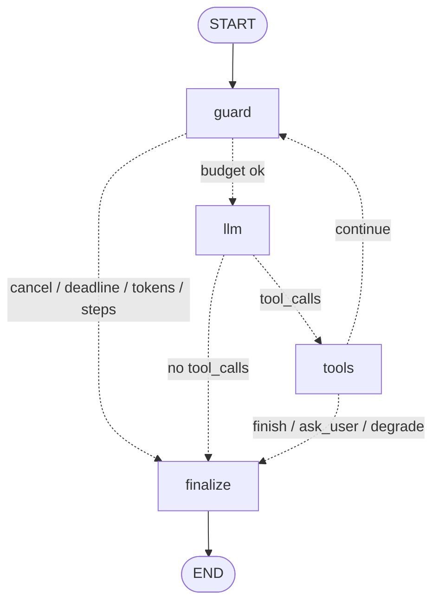

# LangGraph 原型：同一套 Run，换一个调度器

`agent/core/graph_loop.py` 用 LangGraph 的 `StateGraph` 重写了 `agent_loop.run()` 的循环。
**工具、prompt、检索内核、会话存储、输出契约全部复用**，只替换“谁决定下一步”。
共享的运行时、工具派发和落库在 `agent/core/run_support.py`。

## 图



导出：

```python
from agent.core.graph_loop import _graph
print(_graph().get_graph().draw_mermaid())
```

## 节点

| 节点 | 做什么 |
|---|---|
| `guard` | 取消、deadline、token 预算、步数上限；命中就产出 `output` |
| `llm` | 调模型；追加 `AIMessage`；无 tool call 时交给 `classify_no_calls` |
| `tools` | 共享的 `handle_tool_calls`：执行工具、更新 `allowed/candidates/filters`、处理两个出口 |
| `finalize` | `degraded` 兜底、`finalize_and_save`、写回 MySQL（取消时不写） |

条件边：

```python
guard  -> llm | finalize
llm    -> tools | finalize
tools  -> guard | finalize
```

## 和手写循环的映射

| 手写循环 | LangGraph 原型 |
|---|---|
| `for step in range(1, MAX_STEPS + 1)` | `guard` 的步数检查 + `llm.llm_calls` |
| `llm.chat(...)` | `llm` 节点 |
| `registry.run(...)` 的 for 循环 | `tools` 节点（共享 `handle_tool_calls`） |
| `finish` / `ask_user` 后 `break` | 节点设置 `output`，条件边去 `finalize` |
| `_degraded(...)` | `guard` / `tools` / `finalize` 节点 |
| `_finalize` + `store.save` | `finalize` 节点（共享 `finalize_and_save`） |
| `allowed_ids` / `candidates` / `filters` / `pending` | `RunContext` 的字段 |
| `on_event` 状态回调 | 节点内继续调用 `_emit` |
| Fast Path / `turn_id` 幂等 / 会话锁 | 图外，与手写版共用 `prepare_run` |

## 仍然必须自己写的五件事

1. **`allowed_ids` 语义**：search 累加、refine 替换成 `kept_ids`、`exclude_song_ids`/`exclude_tags` 再剔除。
2. **pending 豁免**：只有提问那一轮产生的候选能复用（`last_search.turn_id == pending.turn_id`）。
3. **`finish` 双校验**：白名单 + `satisfies(filters)` + `keep_tags`；两次失败才降级。
4. **`degraded{reasons, at_step, partial}`**：LangGraph 没有对应概念。
5. **会话锁、`turn_id` 幂等、断连取消**：checkpointer 不负责这些。

这也是没有直接用 `create_react_agent` / `ToolNode` 的原因：我们的工具会更新领域状态，
`ToolNode` 只会执行并追加消息；那个副作用必须写在自定义节点里。

## 验证

```bash
# 5 条 parity 单测
python -m pytest agent/tests/test_graph_loop.py -q

# 同一套 30 条 golden，换成 graph 引擎
python -m agent.eval.run_agent_eval --engine graph --min-pass 0.9

# 真实 HTTP 链路（Koa + SSE）切到 graph
AGENT_ENGINE=graph python -m uvicorn agent.app:app --port 8000
python -m agent.e2e_smoke
```

首轮结果：

| 引擎 | golden | P95 | degraded | e2e |
|---|---|---|---|---|
| hand（默认） | 30/30 | 5.51s | 0 | 13/13 |
| graph（原型） | 30/30 | 5.41s | 0 | 13/13 |

全量测试：37 passed（32 + 5 条 graph parity）。

## 怎么在面试里讲

> 我先把 ReAct 循环手写了一遍，明确消息协议、工具 schema、状态合并和护栏；
> 然后把共享的运行时、工具派发、预算检查和落库抽到 `run_support.py`，
> 用 LangGraph 的 StateGraph 把编排重构成 `guard / llm / tools / finalize`
> 四个节点，跑同一套 30 条评测和端到端用例，行为等价。
> 框架替我做的是调度、可视化和后续的 checkpoint/中断；领域状态和护栏仍然是我的节点。

这个叙述比“我用了 LangGraph”更具体：能说清框架做了什么、没做什么。
